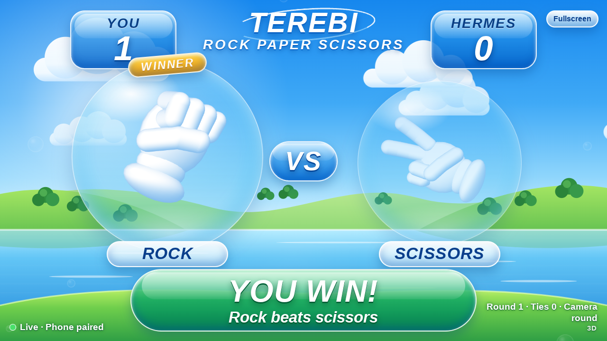

# Hermes Screen

A Jellyfin-first plugin for [Hermes Agent](https://github.com/NousResearch/hermes-agent).
Work in progress for the November 2026 Hermes Agent Plugin Hackathon.

## Implemented today

Twelve tools are registered:

- **`library_status`** checks your configured Jellyfin server, resolves a user, and
  returns the server name/version and available library counts.
- **`library_pick`** (`max_minutes`, optional `limit` 1 to 3, default 3) picks up to
  three watchable items from your Jellyfin library, in this order: unfinished items
  to resume, Next Up episodes, then never-watched movies/videos. Resume and Next Up
  items must fit in their *remaining* time and unwatched items in their full runtime,
  strictly within `max_minutes`; items with unknown runtime are never picked. Each
  pick carries a one-line reason drawn only from Jellyfin's watch state and metadata.
  It only reads the library: it does **not** start anything on the TV.
- **`tv_play`** (`item_id`, optional `media_source_id`, `start_time_s`) validates that the exact Jellyfin item is a directly
  playable local MP4/M4V file (H.264 video up to 1080p, AAC/MP3 or no audio), mints
  an expiring single-item LAN capability URL (`/cast/<token>/video.mp4`), launches
  the Chromecast Default Media Receiver (`CC1AD845`) at `chromecast_host`, and waits
  until the receiver reports a fresh `PLAYING` status for that exact capability URL.
  If that exact item is already `PAUSED` on the receiver with a valid capability,
  calling `tv_play` with the same `item_id` resumes the session.
- **`tv_pause`** (no arguments) pauses the active Hermes Screen media session on the
  configured Chromecast and verifies that the receiver transitions to `PAUSED` on
  the same capability URL and media session.

### Play rock-paper-scissors with Hermes



Say “Let's play rock-paper-scissors.” Hermes returns an expiring phone pairing
link and a display link. Open the camera page in iPhone Safari; mirror the display
from Mac Chrome to Den TV. Hold a fist, open palm, or V through the shared
countdown and the phone submits the recognized move automatically. Images stay
on the phone. Retry unclear gestures without changing the score; tap buttons are
a separately labelled fallback.

The TV display and camera flow are **verified live on hardware**: Den TV
(Chromecast Gen 2), iPhone Safari camera rounds, gesture practice, and
"Stop the game" all passed in the isolated Telegram gateway. With a registered
Custom Receiver the TV launches the game automatically; without one, manual
Chrome mirroring is the fallback. The TV display is **silent by default** —
you can add your own background track when deploying the game service (see
[fresh-device setup](docs/SETUP.md)). See
[setup, pairing and receiver registration](docs/GAMES_RPS.md).

### Describe a saved scene

Save a scene description with a timestamp verified against your exact Jellyfin
edition, then ask for it in your own words. For example, a saved description
“Bunny wakes up and comes out of his burrow” can match “Play the part where the
rabbit gets up and goes outside.” Hermes looks up local descriptions and aliases,
then uses the existing exact-source timestamp playback path. It reports the saved
scene and the receiver-confirmed start position.

Use `library_scene_save` with `item_id`, `media_source_id`, `label`, verified
`start_time_s`, and `description`. Optional `aliases` teach additional phrasings;
optional `end_time_s` is metadata and does not stop playback. Records stay in
profile-local marker state, separately from the movie file. Existing label-only
markers remain available and are not silently treated as scene descriptions.

For requests in the user's own words, Hermes calls `library_scene_find` with
`description`, rather than the subtitle `query` parameter. A clear match returns
one candidate; ambiguous results require a user choice. An unmatched description
offers an explicit timestamp and starts nothing. Lookup itself never starts
playback. Choices are edition- and session-bound and expire after 15 minutes.
Changed scene records or editions require a fresh lookup before playback.

Matching uses a small local phrase/synonym vocabulary and saved aliases. It has no
embedding model, subtitle indexing, or video/frame analysis in this path. Some
paraphrases will not match; it does not understand arbitrary visual scenes.
The Big Buck Bunny three-scene demo is verified live through Telegram
(descriptions played and receiver-confirmed); see
[demo record status](docs/BBB_SCENE_DEMO.md).

### Play a scene from your edition

Ask Hermes: “Find the line ‘keep the lamp burning’ in Lighthouse,” then choose
one of the returned timestamps and ask to play it. `library_scene_find` resolves
movie and edition choices, searches that source's text subtitle track, and shows
caption evidence with original timestamps. Multiple matches require your choice.
Exact and approximate lexical matches are labelled; semantic ranking is disabled
until a local embedding model is approved. It cannot recognize an uncaptioned
visual scene.

For those scenes, supply a timestamp or save a manual marker: “Save one-minute
test scene at 01:00 in BigBuckBunny_320x180.” `library_scene_save` stores the marker
for the selected edition locally. Later ask: “Play one-minute test scene from
BigBuckBunny_320x180.” `tv_scene_play` consumes the selected candidate, starts or
seeks the exact source, and confirms the receiver is PLAYING near its timestamp.
`tv_pause` confirms pause afterward. Ordinary play without a timestamp keeps its
existing resume behavior; an explicit timestamp seeks and starts playing.

A subtitle index refreshes when its source, track or fetched text changes. Subtitle
tracks and indexes stay in local profile state; only matching excerpts are returned
in chat and may be seen by your model provider. Saved markers are user evidence,
not generated scene descriptions. Changed editions invalidate saved markers.
Pending scene choices expire after 15 minutes and belong to the requesting
conversation (or trusted Hermes session on v0.22.0; resetting the session requires
a fresh lookup). Playback rechecks the edition and caption evidence before acting.

The offset must be finite, nonnegative, and below the selected source's runtime.
The receiver's measured position must be within 3 seconds before the requested
point or 3 seconds plus elapsed playback after it. A loaded movie at the wrong
position is reported as unverified. Unsupported video formats still require a
separate transcoding solution; this slice adds none.

Failures return a short reason and a hint. A failed Jellyfin lookup is reported as
an error or a partial result, never as "nothing to watch".

The Jellyfin client also implements library search and Roku `/Sessions` playback
verification (`verify_playback`); those methods are **not** exposed as tools.
All twelve tools are verified live against the Jellyfin `12.2.0` server
(`terebi`), the user's Chromecast Gen 2, YouTube on that Chromecast, and the
standalone game service in the isolated Hermes `v0.22.0` runtime (per-tool
evidence in [docs/evidence](docs/evidence) and [docs/HARDWARE.md](docs/HARDWARE.md)).
The Telegram pick/play/pause, scene, game and YouTube flows are verified.
Programmatic Roku control, TV/CEC wake, `/watch` and Friday voting are not
included.

## Install and configure

Follow the [fresh-device setup path](docs/SETUP.md) — it covers installing the
plugin at an exact commit, Jellyfin + Chromecast settings (including Docker
port forwarding), saved scenes, YouTube with optional title search, the game
service, and Custom Receiver registration, each with a smoke test and a
troubleshooting step.

For local development:

```bash
python -m venv .venv
source .venv/bin/activate
pip install -e '.[dev]'
pytest -q
ruff check .
ruff format --check .
```

Hermes loads the repository as a native directory plugin with `plugin.yaml` and
`__init__.py` at its root. Install/enable that directory using your Hermes plugin
workflow. A Python wheel contains the same layout under `hermes_screen_plugin`;
installing the wheel alone does not enable it in Hermes.

In Hermes plugin settings, set `jellyfin_url` (including any server base path),
optional `jellyfin_user` (exact, case-sensitive username or GUID), and the
`JELLYFIN_API_KEY` secret (Jellyfin Dashboard > API Keys). If user is omitted, the
server must have exactly one enabled user. For Chromecast playback (`tv_play` /
`tv_pause`), also set `chromecast_host`, `cast_media_base_url`, and
`cast_relay_bind`. Settings and secrets are read through Hermes on every tool call;
the plugin does not read `.env` files.

Roku settings are not part of the public configuration because Roku control is not
implemented.

## Version compatibility

- Declared Hermes floor: `requires_hermes: ">=0.22.0"` (in both `plugin.yaml` and,
  later, the catalog entry).
- The compatible source floor was checked against released Hermes **v0.22.0**
  (`e06df9c2eae6901f4c88f464e0ae6e753c0428b8`): official doctor, isolated
  validate, mocked tool smoke (`library_status`, `library_pick`, `tv_play`,
  `tv_pause`), and live Jellyfin 12.2.0 + Chromecast Gen 2 `tv_play` / `tv_pause`
  acceptance passed.
- The installed ZimaOS Hermes is **v0.16.0**, below this plugin's declared
  minimum; testing uses a separate v0.22.0 runtime without upgrading that
  installation.
- Jellyfin requests follow the upstream **12.4.0 OpenAPI** and have been verified
  live against **Jellyfin 12.2.0** (`terebi`) for `library_status`,
  `library_pick(max_minutes=20)`, `tv_play`, `tv_pause`, `get_cast_source`,
  authenticated `HEAD`/`Range` streaming, and Roku 3 `/Sessions` + `verify_playback`.
- Python 3.11+; production dependencies are `httpx>=0.27,<1` and
  `pychromecast>=14,<15`.

See [integration evidence](docs/INTEGRATION.md) for exact commands and revisions.

## Supported configuration and secrets

Public `config_schema` entries (settings via `ctx.get_config`, secrets via
`agent.secret_scope.get_secret`, read on every call):

- `jellyfin_url` — string, required.
- `jellyfin_api_key` — secret, env `JELLYFIN_API_KEY`, read only through Hermes's
  secret scope (`agent.secret_scope.get_secret`). Never from `.env` or
  `os.environ`.
- `jellyfin_user` — string, optional (exact case-sensitive username or GUID).
- `chromecast_host` — string, required for `tv_play` / `tv_pause` (Chromecast LAN IP
  or hostname, e.g. `192.168.1.50`).
- `cast_media_base_url` — string, required for `tv_play` / `tv_pause` (LAN `http://host:port`
  URL the Chromecast fetches from, e.g. `http://192.168.1.20:8765`; never loopback
  or `0.0.0.0`).
- `cast_relay_bind` — string, required for `tv_play` / `tv_pause` (local `IP:port`
  for the temporary media relay listener, e.g. `192.168.1.20:8765` on host or
  `0.0.0.0:8765` inside a bridge-networked container with port `8765` published).

Non-text settings are rejected.

## Validation

Official Hermes v0.22.0 doctor (`12 tool(s), 0 hook(s)`), `hermes plugins
validate . --install-deps`, mocked loader smoke (`tests/hermes_smoke.py`), and
live Jellyfin 12.2.0 + Chromecast Gen 2 acceptance pass; **943 automated Python
tests**, 73 camera JS tests and Ruff pass. `hermes plugins validate
--install-deps` passes with a visible `security scan — caution`
(`bind_all_interfaces` on `playback.py:85`, `plugin.yaml:58`, `relay.py:158`,
`relay.py:166`, and `tunnel_service` on `games/deploy/compose.yaml:22`) because
containerized setups can configure `cast_relay_bind` as `0.0.0.0:8765` and the
game deploy intentionally runs a tunnel sidecar. Details are in
[integration evidence](docs/INTEGRATION.md). Catalog rules distinguish a
validation failure from a caution finding requiring review.

## Catalog submission

This plugin is being prepared for the Hermes plugin catalog:
[docs/SUBMISSION.md](docs/SUBMISSION.md) holds the checklist, the draft catalog
entry, and the verified-versus-mocked evidence summary. The pinned commit for
the upstream catalog PR is recorded there once this PR lands.

## Live verification record

- Live `tv_play`/`tv_pause` through the integrated relay passed on Chromecast
  Gen 2 from the isolated Hermes `v0.22.0` runtime.
- Roku 3 programmatic control remains unavailable (Roku's third-party ECP
  restriction; live `/Sessions` confirms `SupportsMediaControl: false` on
  `Jellyfin Roku` `3.2.4`). The Roku path was abandoned in favor of Chromecast.
- TV/CEC wake is out of scope and unverified.
- `library_pick`, `tv_play`, `tv_pause`, scene save/find/play, game
  start/stop, and YouTube play/pause are verified from Telegram; `/watch` is
  not built.

## Troubleshooting

- Missing settings: set `jellyfin_url`, `JELLYFIN_API_KEY`, and (for Chromecast)
  `chromecast_host`, `cast_media_base_url`, and `cast_relay_bind` in Hermes, then retry.
- Ambiguous user: set the exact username or GUID; the plugin never picks the first user.
- Authentication failure: check the API key and user permissions.
- Connection failure: check the Jellyfin URL, Chromecast IP, and LAN reachability.
- Chromecast stays `IDLE` on `tv_play`: verify `cast_media_base_url` uses the host's
  LAN IP reachable from the Chromecast and that `cast_relay_bind` port is forwarded
  to the Hermes runtime.

## Privacy and network use

- `library_status` and `library_pick` make HTTP requests only to the configured
  Jellyfin server with explicit 8-second timeouts (`follow_redirects=False`).
- `tv_play` and `tv_pause` connect directly to the configured `chromecast_host` on
  TCP port `8009` (no mDNS broadcast discovery is required when an IP is given) and
  run a local `ThreadingHTTPServer` bound to `cast_relay_bind` while a capability is
  active.
- `JELLYFIN_API_KEY` is never placed in capability URLs or sent to the Chromecast;
  the relay mints a single 256-bit random capability token (`/cast/<token>/video.mp4`)
  with a bounded TTL (15 minutes to 4 hours, `duration_s + 900s`), forwards `GET`/`HEAD`
  and byte-range requests to Jellyfin's static stream endpoint with `Authorization` in
  the upstream header only, redacts capability paths from logs, and revokes the
  capability + closes the listener on expiry or plugin unload (`ctx.on_unload`).
- Server/user names and library data returned in chat may be seen by your model provider.
- `tv_youtube_play` / `tv_youtube_pause` connect to the configured Chromecast and
  let YouTube serve the video directly; `library_youtube_search` (optional) calls
  YouTube Data API v3 with your Hermes-stored key. No scraping, download or media
  relay for YouTube.
- The game service is a separate deployment you own: the phone camera page, the
  TV receiver/display and a small JSON API. Camera frames and landmarks never
  leave the phone. The public HTTPS origin (typically a Cloudflare Quick Tunnel)
  carries game pages, tokens and API requests; camera images do not cross it.
  Game credentials are one-use pairing links, expiring read-only viewer
  capabilities and a generated admin token kept in Hermes secret scope.
- The TV display/receiver loads Google's CAF v3 SDK from `www.gstatic.com`; the
  game's background music track is served same-origin from the game service.

## Contributing

Read [AGENTS.md](AGENTS.md), [SOUL.md](SOUL.md) and [the plan](docs/PLAN.md).
All automated HTTP and Cast tests use mocks/fakes; live hardware verification is
recorded in [docs/HARDWARE.md](docs/HARDWARE.md).

## License

MIT


### Direct Chromecast game launch (registered Custom Receiver)

Configure `games_receiver_app_id` with a Google Cast Custom Receiver ID and use
the existing `chromecast_host`. Deploy the game service's `/receiver/` page and
register that trusted HTTPS URL in Google's Console. Unpublished tests require
registering the Chromecast as a test device. See [setup and acceptance steps](docs/GAMES_CAST.md).

Hermes launches the game and sends only the session's read-only display capability.
It reports the TV ready only after the receiver acknowledges rendering the same
session. The iPhone pairing link is still returned in Telegram. Failed or
unconfigured launches retain the manual Chrome display link. Starting a game
replaces the current Chromecast app; TV wake and HDMI switching are separately
tested device behavior, not implied by receiver readiness.


### YouTube on Chromecast

Send Hermes a YouTube video link or ID: “Play https://youtu.be/aqz-KE-bpKQ on TV.”
`tv_youtube_play` uses the configured `chromecast_host`; YouTube serves the video
directly. No API key, media relay or download is needed for a link. This replaces
the current TV app. `tv_youtube_pause` pauses only the YouTube video/session this
plugin context verified. Asking to play the same paused video resumes it.
Existing `tv_pause` continues to control Jellyfin movies.

Success requires fresh receiver evidence for the requested video ID and state.
`app_opened` means the YouTube app opened but playback was not confirmed. Check the
TV for ads, sign-in, age/region restrictions or unavailable/private videos; never
interpret an app launch as confirmed video playback. Supported inputs: an
11-character video ID, HTTPS watch/youtu.be/shorts/embed/live video links.
Playlists and timestamp offsets are not supported.

For optional title search, enable **YouTube Data API v3** in your Google Cloud
project and configure `YOUTUBE_API_KEY` through Hermes secret settings. Restrict
the key to that API and set an appropriate quota. `library_youtube_search` returns
up to five titles/channels; choose a result before playing. Without the key, Hermes
asks for a direct link. No YouTube page scraping is used. Search availability is
independent of playback availability on the TV.


### Stop rock-paper-scissors

Tell Hermes **“Stop the game”** or **“Exit rock-paper-scissors”** in the conversation
that started it. The game ends, old links are revoked, the phone shows **Game ended**
and releases its camera, and the matching TV receiver exits to Chromecast artwork.
Other apps and newer games are left alone. A repeated stop is safe. Hermes reports
session end separately if TV closure cannot be confirmed. Start again for a fresh
pairing link. See [the stop protocol and live checklist](docs/GAMES_STOP.md).
